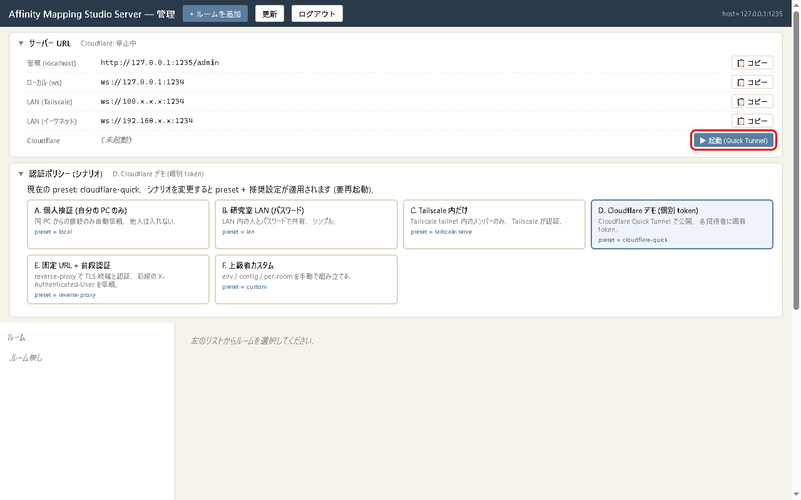
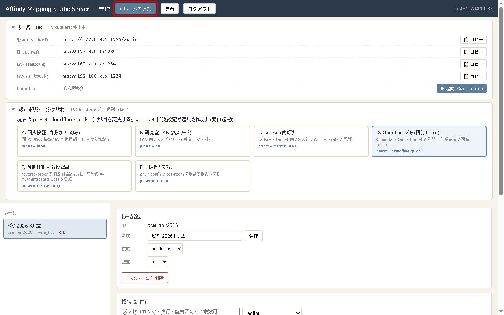
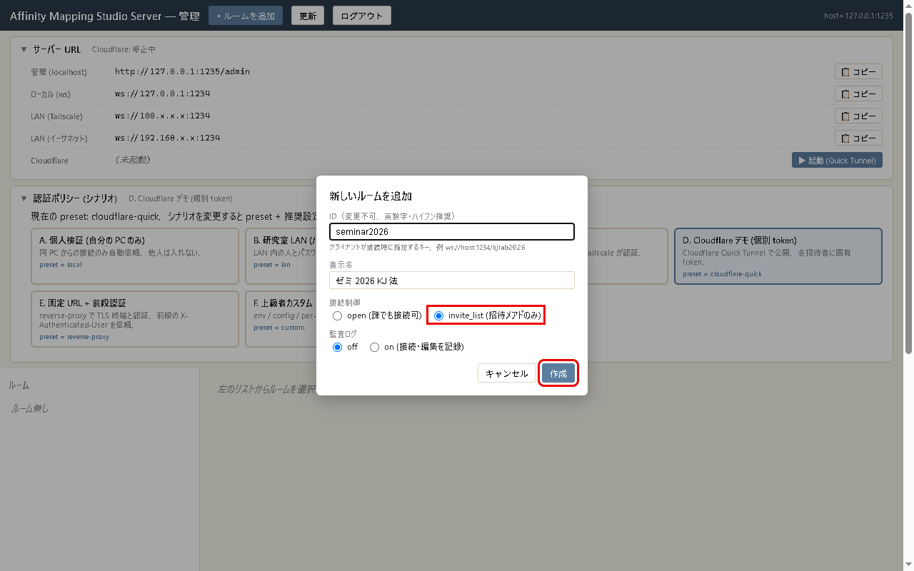
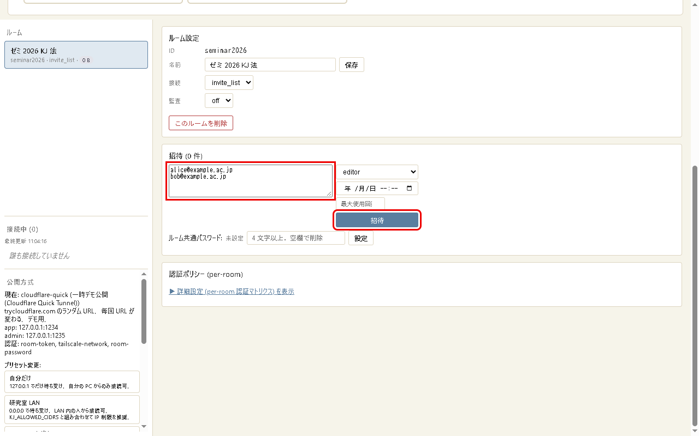
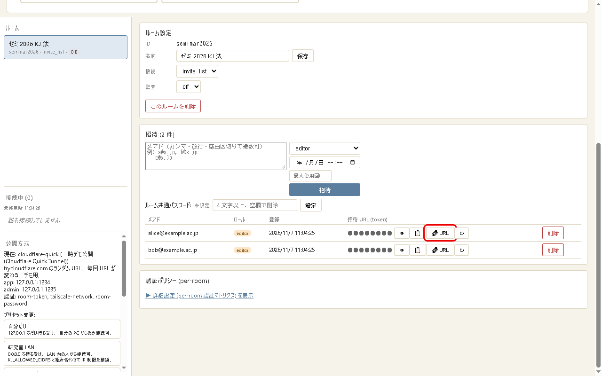

# Getting Started (from setup to co-editing)

[日本語](getting-started.ja.md)

Affinity Mapping Studio Server (AMS Server) lets several people edit the same diagram in [Affinity Mapping Studio](https://github.com/YukiInoueNakata/affinity-mapping-studio) at the same time.
This guide shows how to run the server on your own computer and let people outside your network join through a temporary Cloudflare tunnel.

- You only type commands to install and start the server. Creating rooms, inviting people, and going public are all done with buttons in the admin page in your browser.
- Follow the red boxes in the pictures, in order.
- The admin page is in Japanese. Each button is given here as its Japanese label followed by an English gloss.
- For participants (people using the app), see section 6 of the app guide: [Collaborative editing (connecting to a server)](https://github.com/YukiInoueNakata/affinity-mapping-studio/blob/main/docs/getting-started.en.md#6-collaborative-editing-connecting-to-a-server).

## Contents

- [0. Overview and safety rules](#0-overview-and-safety-rules)
- [1. Prepare (first time only)](#1-prepare-first-time-only)
- [2. Setup wizard (first time only)](#2-setup-wizard-first-time-only)
- [3. Start the server and open the admin page](#3-start-the-server-and-open-the-admin-page)
- [4. Let outside people join (Quick Tunnel)](#4-let-outside-people-join-quick-tunnel)
- [5. Create a room](#5-create-a-room)
- [6. Invite participants](#6-invite-participants)
- [7. When you are done (stop)](#7-when-you-are-done-stop)
- [8. From the second time on](#8-from-the-second-time-on)
- [9. Troubleshooting](#9-troubleshooting)

## 0. Overview and safety rules

```
Prepare (Node.js, cloudflared, the server) -> wizard -> start
  -> admin page: start the tunnel -> create a room -> invite -> send invite URLs
  -> work -> stop the tunnel -> stop the server
```

Please keep these four rules.

| Rule | Why |
|---|---|
| Never show or send the admin page (`http://127.0.0.1:1235/admin`) or the admin token to anyone | The admin page can delete rooms and issue invitations. It only opens on the computer running the server |
| Set rooms you expose to the internet to "invite_list" | People without an invite URL cannot get in |
| Send each invite URL only to its owner, one by one | An invite URL is a key. Do not paste it into group chats or public places |
| Stop the tunnel when you are not using it | While it is stopped, nobody from outside can get in |

## 1. Prepare (first time only)

You need three things.

| Item | What for |
|---|---|
| Node.js (20 or later) | Runs the server |
| cloudflared | Creates a temporary public URL (not needed if you only use the server on your own computer) |
| The server | This repository |

### Windows

Open PowerShell (type "PowerShell" in the Start menu) and paste these lines one by one, pressing Enter after each.

```powershell
winget install --id OpenJS.NodeJS.LTS -e
winget install --id Cloudflare.cloudflared -e
winget install --id Git.Git -e
```

Close PowerShell and open it again so that it finds the new programs.

### Mac

Open Terminal. If you have [Homebrew](https://brew.sh/), paste:

```bash
brew install node cloudflared git
```

### Check

```bash
node -v
cloudflared --version
```

You are ready if `node -v` prints `v20` or higher.

### Get the server

In a folder of your choice (for example Documents), run:

```bash
git clone https://github.com/YukiInoueNakata/affinity-mapping-studio-server.git
cd affinity-mapping-studio-server
npm install
```

Without git, use "Code" -> "Download ZIP" on the GitHub page, unzip it, open a terminal in that folder, and run `npm install`.

## 2. Setup wizard (first time only)

In the server folder, run:

```bash
npm run setup
```

The wizard asks questions in Japanese. To work with people outside your network, answer `5` (Cloudflare Quick Tunnel) to the first question and just press Enter for everything else.

```
1. 公開方式 (exposure) を選んでください:        (choose how to expose the server)
  [1] 自分だけ (local)                          (only this computer)
  [2] 研究室 LAN (lan)                          (lab LAN)
  ...
  [5] 一時デモ公開 (Cloudflare Quick Tunnel) (cloudflare-quick)
  ...
番号を入力 [1]: 5

2. ネットワーク設定 (空欄で既定値):             <- Enter four times
3. 認証方式:                                    (authentication)
  legacy email 自己申告を許可? ... [y/N]:       <- Enter (do not allow)
  ip-cidr allowlist ... []:                     <- Enter
4. 管理トークン:                                (admin token)
  新規 token を生成しました                     (a new token was generated)

保存しますか? [Y/n]:                            <- Enter (save)
```

This creates `config/server.json` (settings) and `config/admin-token.txt` (admin token).
To try the server only on your own computer, answer `1` (local) to the first question.

## 3. Start the server and open the admin page

In the server folder, run:

```bash
npm start
```

When you see `admin listening on http://127.0.0.1:1235`, the server is running. Leave this terminal open (closing it stops the server).

Open this URL in your browser:

```
http://127.0.0.1:1235/admin
```

The page asks for the admin token ("管理トークンを入力してください"). Paste it and press OK. To show the token, run this in another terminal:

```powershell
# Windows (PowerShell)
Get-Content config\admin-token.txt
```

```bash
# Mac
cat config/admin-token.txt
```

The admin page opens. From the top: "サーバー URL" (server URLs), "認証ポリシー（シナリオ）" (authentication scenarios), and "ルーム" (rooms).

## 4. Let outside people join (Quick Tunnel)

Press "▶ 起動 (Quick Tunnel)" (start) at the lower right of the "サーバー URL" box.



Press OK in the confirmation. After a few seconds you see "起動成功" (started), and the "Cloudflare" row shows a URL like `https://xxxx.trycloudflare.com`.

- The URL changes every time you start the tunnel.
- One tunnel lasts up to 7 days. The intended use is to start it before each session and stop it afterwards.
- If the "Cloudflare" row says "cloudflared 未インストール" (not installed), install cloudflared ([1. Prepare](#1-prepare-first-time-only)) and restart the server.

## 5. Create a room

Co-editing happens in a "room". Make one room per project.

Press "+ ルームを追加" (add room) at the top.



Fill in three fields and press "作成" (create).

| Field | What to enter |
|---|---|
| ID | Letters, digits, and hyphens (e.g. `seminar2026`). Cannot be changed later |
| 表示名 (display name) | Any name you like |
| 接続制御 (access) | Choose **invite_list (招待メアドのみ, invited addresses only)** |

Turn "監査ログ" (audit log) on only when your research needs a record of who did what and when.



## 6. Invite participants

Select the room in the "ルーム" list on the left. Its settings appear on the right.
Type the participants' email addresses in the "招待" (invite) box (one per line) and press "招待".



- The menu on the right sets the role: editor (can edit, default), viewer (read only), admin (can edit and also roll the whole room back to a saved earlier state). Give admin to one person only, such as yourself.
- Leave the expiry date and maximum uses empty.

The invited people appear in a table. Press "URL" in a person's row to copy that person's invite URL.



Send the copied invite URL **only to that person**, for example by email. It looks like this:

```
wss://xxxx.trycloudflare.com/seminar2026?t=<that person's invite token>&nick=alice
```

Participants paste the invite URL into the app's "Connect to a server and join an existing room…" dialog ([app guide](https://github.com/YukiInoueNakata/affinity-mapping-studio/blob/main/docs/getting-started.en.md#6-collaborative-editing-connecting-to-a-server)).
Connected people appear under "接続中" (connected) at the lower left.

- Start the tunnel before pressing "URL". Otherwise you copy a `ws://` URL that only works inside your LAN.
- If someone else has seen an invite URL, press "↻" in that row to issue a new invite token and send the new URL. The old URL stops working.
- To remove a participant, press "削除" (delete) in that row.

## 7. When you are done (stop)

1. In the admin page, press "⏹ 停止" (stop) in the "Cloudflare" row and press OK. Nobody from outside can get in any more.
2. In the terminal running `npm start`, press Ctrl + C. The server stops.

Your work is saved in the `data/` folder of the server. Start the server again to continue.

## 8. From the second time on

You do not need to prepare or run the wizard again.

1. `npm start` in the server folder
2. Open the admin page (`http://127.0.0.1:1235/admin`) and enter the admin token
3. Press "▶ 起動 (Quick Tunnel)"
4. **The tunnel URL has changed, so press "URL" for each participant and send the invite URLs again** (the invite tokens stay the same)
5. When done, see [7. When you are done](#7-when-you-are-done-stop)

To update the server, stop it and run in the server folder:

```bash
git pull
npm install
```

## 9. Troubleshooting

| What happens | Cause and fix |
|---|---|
| `npm start` stops with `EADDRINUSE` (address already in use) | Another copy of the server is running. Find the earlier terminal, press Ctrl + C there, and start again |
| The admin page says "認証エラー: トークンが違います" (wrong token) | The token was pasted incorrectly. The page asks again after reloading; paste the contents of `config/admin-token.txt` without extra spaces |
| The admin page does not open | The server is not running. Check that the `npm start` terminal is still open. The admin page only opens in a browser on the computer running the server |
| Participants cannot connect (second time or later) | The tunnel URL has changed. Press "URL" and send the invite URLs again |
| Participants connect but are disconnected right away | The invitation was deleted, or they use an old URL replaced with "↻". Send a new invite URL. If their app is old, ask them to update it |
| The "Cloudflare" row says "cloudflared 未インストール" | Install cloudflared ([1. Prepare](#1-prepare-first-time-only)) and restart the server |
| "▶ 起動" shows "起動失敗" (failed) | Your network may block Cloudflare. Wait and try again, or try another network |
| You want to keep a copy of the room data | Stop the server and copy the whole `data/` folder somewhere else |

For detailed settings (LAN, Tailscale, fixed-URL publishing, audit log CSV export, command-line administration), see the [README](../README.md).
