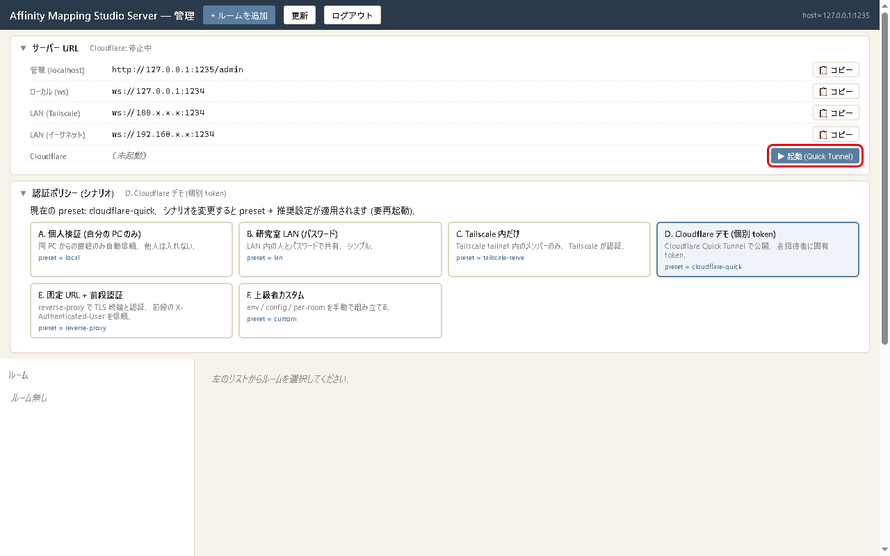
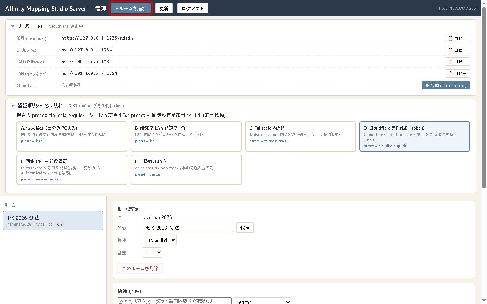
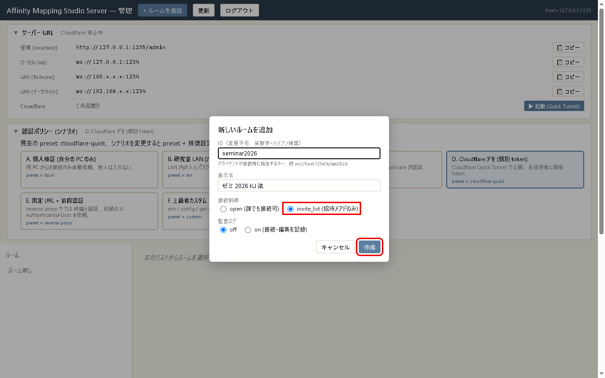
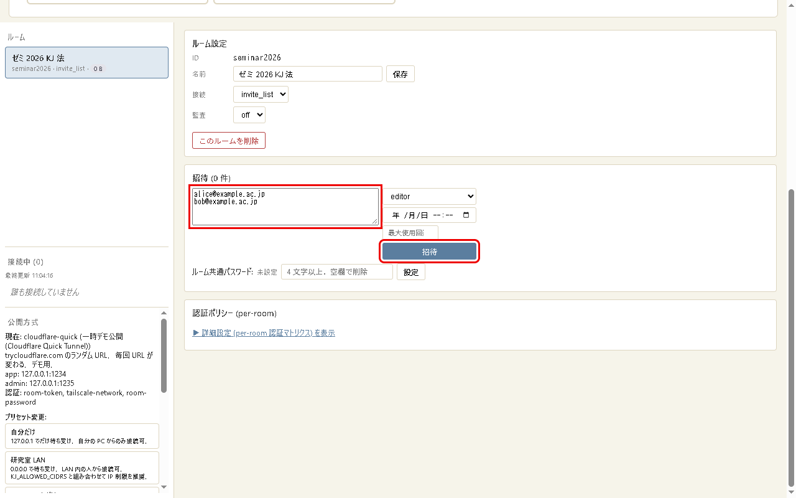
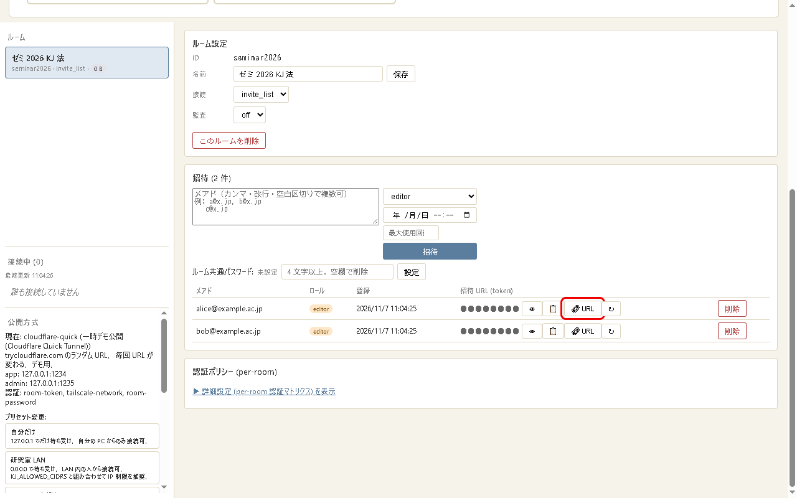

# はじめてのガイド（サーバーの準備から共同編集まで）

[English](getting-started.en.md)

Affinity Mapping Studio Server（AMS Server）は，[Affinity Mapping Studio](https://github.com/YukiInoueNakata/affinity-mapping-studio) で何人かが同時に同じ図を編集するためのサーバーです．
このガイドでは，自分の PC でサーバーを動かし，Cloudflare の一時的なトンネルで外の人にも参加してもらうまでを説明します．

- コマンドを打つのは「準備」と「起動」だけです．部屋の作成・招待・公開は，ブラウザの管理画面でボタンを押して行います．
- 画像の赤い枠のところを順に押していけば進めます．
- 参加する側（アプリを使う人）の手順は，アプリのガイドの [6. 共同編集（サーバーにつなぐ）](https://github.com/YukiInoueNakata/affinity-mapping-studio/blob/main/docs/getting-started.ja.md#6-共同編集サーバーにつなぐ) にあります．

## 目次

- [0. 全体の流れと安全のための約束](#0-全体の流れと安全のための約束)
- [1. 準備（最初の 1 回だけ）](#1-準備最初の-1-回だけ)
- [2. 初期設定のウィザード（最初の 1 回だけ）](#2-初期設定のウィザード最初の-1-回だけ)
- [3. サーバーを起動して管理画面に入る](#3-サーバーを起動して管理画面に入る)
- [4. 外から参加できるようにする（Quick Tunnel）](#4-外から参加できるようにするquick-tunnel)
- [5. 部屋を作る](#5-部屋を作る)
- [6. 参加者を招待する](#6-参加者を招待する)
- [7. 終わるとき（停止）](#7-終わるとき停止)
- [8. 2 回目からの使い方](#8-2-回目からの使い方)
- [9. 困ったとき](#9-困ったとき)

## 0. 全体の流れと安全のための約束

```
準備（Node.js・cloudflared・サーバー本体）→ ウィザード → 起動
  → 管理画面: トンネルを起動 → 部屋を作る → 招待 → 招待 URL を参加者に渡す
  → 作業 → トンネルを停止 → サーバーを停止
```

安全のため，次の 4 つを守ってください．

| 約束 | 理由 |
|---|---|
| 管理画面（`http://127.0.0.1:1235/admin`）と管理トークンは，誰にも見せない・送らない | 管理画面からは部屋の削除や招待の発行ができます．管理画面は自分の PC からしか開けない作りです |
| 外に公開する部屋は「invite_list（招待した人だけ）」にする | 招待 URL を持たない人は入れなくなります |
| 招待 URL は 1 人ずつ，本人にだけ送る | 招待 URL は合い鍵です．グループのチャットや公開の場所に貼らないでください |
| 使わないときはトンネルを止める | 止めている間は，外から誰も入れません |

## 1. 準備（最初の 1 回だけ）

必要なものは 3 つです．

| もの | 何のためか |
|---|---|
| Node.js（20 以上） | サーバーを動かす |
| cloudflared | 外から参加できる一時的な URL を作る（自分の PC の中だけで使うなら不要） |
| サーバー本体 | このリポジトリ |

### Windows

PowerShell を開き（スタートメニューで「PowerShell」と打つ），1 行ずつ貼り付けて Enter を押します．

```powershell
winget install --id OpenJS.NodeJS.LTS -e
winget install --id Cloudflare.cloudflared -e
winget install --id Git.Git -e
```

入れ終わったら PowerShell をいったん閉じて，開き直します（入れたものを PowerShell に認識させるため）．

### Mac

ターミナルを開き，[Homebrew](https://brew.sh/) が入っていれば次を貼り付けます．

```bash
brew install node cloudflared git
```

### 確かめる

```bash
node -v
cloudflared --version
```

`node -v` が `v20` 以上の数字を返せば準備はできています．

### サーバー本体を取ってくる

置きたい場所（例: ドキュメント）で次を実行します．

```bash
git clone https://github.com/YukiInoueNakata/affinity-mapping-studio-server.git
cd affinity-mapping-studio-server
npm install
```

git を使わない場合は，GitHub のページの「Code」→「Download ZIP」で取ってきて展開し，そのフォルダでターミナルを開いて `npm install` を実行します．

## 2. 初期設定のウィザード（最初の 1 回だけ）

サーバーのフォルダで次を実行します．

```bash
npm run setup
```

質問が順に出ます．外の人と使うときは，最初の質問で `5`（一時デモ公開 (Cloudflare Quick Tunnel)）を選び，あとは何も入れずに Enter を押していけば大丈夫です．

```
1. 公開方式 (exposure) を選んでください:
  [1] 自分だけ (local)
  [2] 研究室 LAN (lan)
  ...
  [5] 一時デモ公開 (Cloudflare Quick Tunnel) (cloudflare-quick)
  ...
番号を入力 [1]: 5

2. ネットワーク設定 (空欄で既定値):       ← 4 つとも Enter
3. 認証方式:
  legacy email 自己申告を許可? ... [y/N]: ← Enter（許可しない）
  ip-cidr allowlist ... []:              ← Enter
4. 管理トークン:
  新規 token を生成しました

保存しますか? [Y/n]:                      ← Enter
```

これで `config/server.json`（設定）と `config/admin-token.txt`（管理トークン）ができます．
自分の PC の中だけで試すなら，最初の質問で `1`（自分だけ）を選びます．

## 3. サーバーを起動して管理画面に入る

サーバーのフォルダで次を実行します．

```bash
npm start
```

`admin listening on http://127.0.0.1:1235` と出れば起動しています．このターミナルは閉じずにそのままにしておきます（閉じるとサーバーが止まります）．

次に，ブラウザで次の URL を開きます．

```
http://127.0.0.1:1235/admin
```

「管理トークンを入力してください」と聞かれるので，管理トークンを貼り付けて OK を押します．管理トークンは，別のターミナルで次を実行すると表示されます．

```powershell
# Windows（PowerShell）
Get-Content config\admin-token.txt
```

```bash
# Mac
cat config/admin-token.txt
```

管理画面が開きます．上から順に「サーバー URL」「認証ポリシー（シナリオ）」「ルーム」が並んでいます．

別の起動のしかたとして，Windows ではサーバーのフォルダの `start-server.bat` をダブルクリックしても起動できます（Mac は `./start-server.sh`）．この場合は管理画面が管理トークンを入れた状態で自動で開き，ウィザードで Quick Tunnel を選んでいれば，次の節のトンネルも自動で張られます．止めるときは，開いた黒いウィンドウを閉じます（Mac は Ctrl + C）．

## 4. 外から参加できるようにする（Quick Tunnel）

「サーバー URL」の欄の右下にある「▶ 起動 (Quick Tunnel)」を押します．



確認が出るので OK を押します．数秒で「起動成功」と出て，「Cloudflare」の行に `https://○○○.trycloudflare.com` の形の URL が表示されます．

- この URL は，トンネルを起動するたびに変わります．
- 1 回の起動で使えるのは最長 7 日間です．毎回の作業の前に起動し，終わったら止める使い方を想定しています．
- 「Cloudflare」の行に「cloudflared 未インストール」と出るときは，[1. 準備](#1-準備最初の-1-回だけ) の cloudflared を入れてから，サーバーを起動し直します．

## 5. 部屋を作る

共同編集は「部屋（ルーム）」ごとに行います．1 つのプロジェクトに 1 つの部屋を作ります．

画面の上の「+ ルームを追加」を押します．



次の 3 つを入れて「作成」を押します．

| 欄 | 入れるもの |
|---|---|
| ID | 半角の英数字とハイフン（例 `seminar2026`）．あとから変えられません |
| 表示名 | 分かりやすい名前（日本語でよい） |
| 接続制御 | **invite_list（招待メアドのみ）** を選ぶ |

監査ログは，研究で「誰がいつ何をしたか」の記録が要るときだけ on にします．



## 6. 参加者を招待する

左の「ルーム」の一覧で作った部屋を選ぶと，右に部屋の設定が出ます．
「招待」の欄に参加者のメールアドレスを入れて（複数なら改行で区切る），「招待」を押します．



- 右の選択肢で役割を選べます．editor（編集できる・既定），viewer（見るだけ），admin（編集に加えて，保存された過去の状態に部屋全体を巻き戻せる）．admin は自分など 1 人だけにします．
- 有効期限と最大使用回数は空欄のままで構いません．

招待した人が表に並びます．参加者ごとに「URL」を押すと，その人の招待 URL がコピーされます．



コピーした招待 URL を，メールなどで**その人にだけ**送ります．形は次のとおりです．

```
wss://○○○.trycloudflare.com/seminar2026?t=<その人の招待トークン>&nick=alice
```

参加者は，アプリの「サーバーに接続して既存ルームに参加…」で招待 URL を貼り付けて接続します（[アプリのガイド](https://github.com/YukiInoueNakata/affinity-mapping-studio/blob/main/docs/getting-started.ja.md#6-共同編集サーバーにつなぐ)）．
左下の「接続中」に，つながっている人が表示されます．

- 「URL」を押す前にトンネルを起動してください．起動していないと，LAN の中だけで使える `ws://` の URL がコピーされます．
- 招待 URL を他の人に見られたときは，その人の行の「↻」で招待トークンを作り直し，新しい招待 URL を送り直します．古い URL は使えなくなります．
- 参加をやめてもらうときは，その人の行の「削除」を押します．

## 7. 終わるとき（停止）

1. 管理画面の「Cloudflare」の行の「⏹ 停止」を押し，確認で OK を押します．外からは入れなくなります．
2. `npm start` を実行したターミナルで Ctrl + C を押します．サーバーが止まります．

編集した内容はサーバーのフォルダの `data/` に保存されています．次に起動すれば続きから使えます．

## 8. 2 回目からの使い方

準備とウィザードは要りません．

1. サーバーのフォルダで `npm start`
2. 管理画面（`http://127.0.0.1:1235/admin`）を開いて管理トークンを入れる
3. 「▶ 起動 (Quick Tunnel)」を押す
4. **トンネルの URL が前回と変わっているので，参加者ごとに「URL」を押して招待 URL を送り直す**（招待トークンは前回と同じです）
5. 終わったら [7. 終わるとき](#7-終わるとき停止)

サーバーを新しい版にするときは，サーバーを止めてから，サーバーのフォルダで次を実行します．

```bash
git pull
npm install
```

## 9. 困ったとき

| 起きること | 原因と対処 |
|---|---|
| `npm start` が `EADDRINUSE`（address already in use）と出て止まる | サーバーがもう 1 つ動いています．前に開いたターミナルを探して Ctrl + C で止めてから起動し直します |
| 管理画面で「認証エラー: トークンが違います」と出る | 管理トークンの貼り間違いです．再読み込みで聞き直されるので，`config/admin-token.txt` の中身を前後の空白なしで貼り直します |
| 管理画面が開かない | サーバーが動いていません．`npm start` のターミナルが開いたままかを確かめます．管理画面は，サーバーを動かしている PC のブラウザでしか開けません |
| 参加者が「つながらない」と言う（2 回目以降） | トンネルの URL が変わっています．「URL」を押して招待 URL を送り直します |
| 参加者がつながってもすぐ切れる | 招待が削除されたか，「↻」で作り直された古い招待 URL を使っています．新しい招待 URL を送ります．アプリが古い版のときは，新しい版にしてもらいます |
| 「Cloudflare」の行に「cloudflared 未インストール」と出る | cloudflared を入れ（[1. 準備](#1-準備最初の-1-回だけ)），サーバーを起動し直します |
| 「▶ 起動」を押しても「起動失敗」と出る | ネットワークが Cloudflare への接続を止めていることがあります．しばらく待って押し直すか，別のネットワークで試します |
| 部屋のデータを残しておきたい | サーバーを止めてから，`data/` のフォルダを丸ごと別の場所に写します |

設定の細かな項目（LAN・Tailscale・固定 URL での公開，監査ログの CSV 出力，コマンドでの管理）は [README](../README.md) を見てください．
